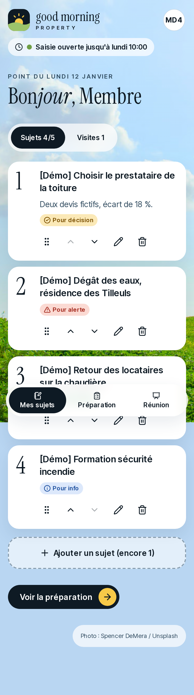
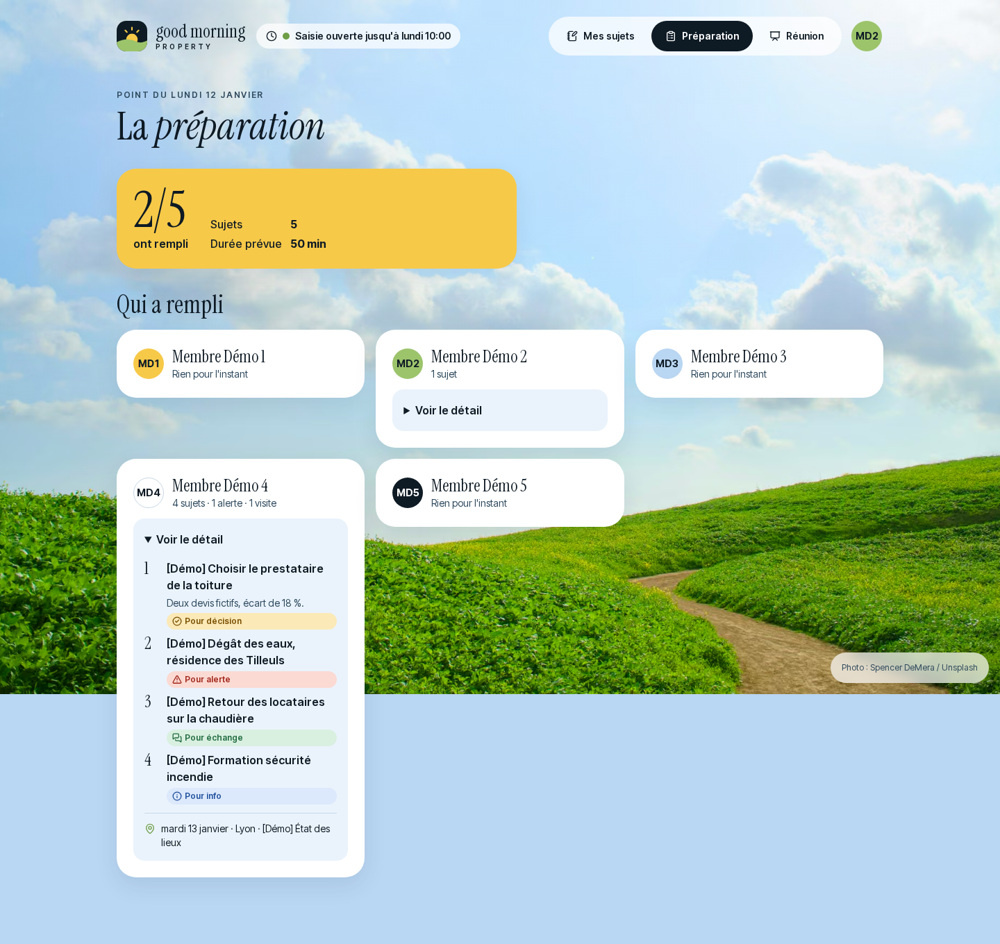
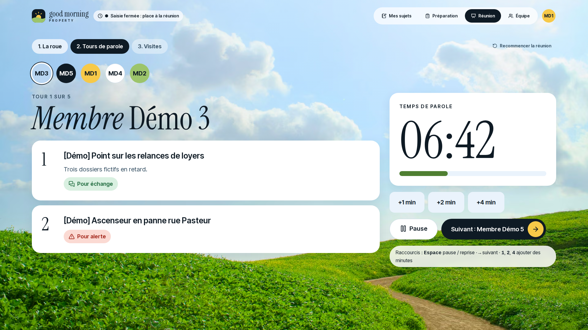

# Good Morning Property

Application web qui anime le **point hebdomadaire d'une équipe de cinq personnes**, le lundi à
11 h. Fini le tour de table des tâches de la semaine passée : chacun prépare l'essentiel, la
réunion est projetée, chronométrée, et rien n'est conservé après.

| Saisie (mobile)                                       | Préparation                                      | Réunion projetée                                     |
| ----------------------------------------------------- | ------------------------------------------------ | ---------------------------------------------------- |
|  |  |  |

_Captures réalisées avec des données fictives._

## Fonctionnement en 5 lignes

1. **Du mardi au lundi 10 h** (heure de Paris), chacun saisit jusqu'à **5 sujets** priorisés et
   tagués (info, échange, décision, alerte) et ses **visites et déplacements** de la semaine.
2. Avant la réunion, chacun ne voit que ses saisies ; tout le monde voit **qui a rempli** ; seul le
   **responsable** voit le contenu de tous.
3. Le lundi, l'**animateur** projette `/reunion` : présents, **roue** pour l'ordre de passage,
   **10 minutes** par personne (+1/+2/+4), alerte visuelle et sonore sans couper la parole.
4. La réunion se termine par le **tour des visites**. **Rien n'est enregistré** après.
5. **Aucun mail** : chacun entre avec son **lien personnel**, créé et transmis par l'animateur
   depuis l'écran Équipe.

## Prérequis

- **Node 22 LTS** (`nvm use` lit `.nvmrc`)
- **pnpm 10** (`corepack enable` utilise la version figée dans `package.json`)
- **Docker Desktop** (Supabase tourne en local, voir `docs/local-dev.md`)

## Installation

```bash
corepack enable
```

```bash
pnpm install
```

```bash
pnpm db:start && pnpm db:reset
```

```bash
cp .env.example .env.local
```

Colle dans `.env.local` les valeurs affichées par `pnpm db:env`, puis :

```bash
pnpm dev
```

```bash
pnpm local:link -- --email membre1@example.test
```

Ouvre le lien affiché : tu es connecté comme « Membre Démo 1 » (animateur, données fictives).

## Commandes

| Commande                                                         | Rôle                                                     |
| ---------------------------------------------------------------- | -------------------------------------------------------- |
| `pnpm dev`                                                       | serveur de développement                                 |
| `pnpm build` / `pnpm start`                                      | build et serveur de production                           |
| `pnpm check`                                                     | lint + typecheck + tests unitaires (Vitest)              |
| `pnpm test:db`                                                   | tests de la base (pgTAP, Supabase local)                 |
| `pnpm test:integration`                                          | tests d'intégration Vitest contre Supabase local         |
| `pnpm test:e2e`                                                  | tests Playwright + axe sur le build (`pnpm build` avant) |
| `pnpm format` / `format:check`                                   | Prettier (+ tri des classes Tailwind)                    |
| `pnpm db:start` / `db:stop` / `db:reset` / `db:types` / `db:env` | Supabase local                                           |
| `pnpm local:link -- --email …`                                   | lien personnel d'un membre du seed (local uniquement)    |
| `pnpm bootstrap:facilitator -- --name "…"`                       | premier animateur d'une base vide                        |
| `pnpm optimize:background`                                       | flou de chargement de la photo de fond                   |

## Documentation

- [`CLAUDE.md`](CLAUDE.md) : contexte, conventions et règles absolues
- [`docs/deploy.md`](docs/deploy.md) : **mise en ligne pas à pas**
- [`docs/auth.md`](docs/auth.md) : liens personnels et écran Équipe
- [`docs/calendar.md`](docs/calendar.md) : calendrier de réunion (heure de Paris)
- [`docs/entries.md`](docs/entries.md), [`docs/preparation.md`](docs/preparation.md),
  [`docs/meeting.md`](docs/meeting.md) : écrans
- [`docs/data-model.md`](docs/data-model.md), [`docs/local-dev.md`](docs/local-dev.md) : base de
  données, RLS, Supabase local
- [`docs/design.md`](docs/design.md) : direction artistique « Prairie du matin », accessibilité
- [`docs/architecture.md`](docs/architecture.md), [`docs/security.md`](docs/security.md)
- [`docs/progress.md`](docs/progress.md) : avancement par phase

## Crédits

Photo de fond : « Rolling green hills under a bright, blue sky », **Spencer DeMera** sur
[Unsplash](https://unsplash.com/photos/q0lB6w0z6Ns), licence Unsplash.
Polices : Instrument Serif et Inter Tight (SIL Open Font License), hébergées dans
`src/app/fonts/` (licence dans `OFL.txt`).
