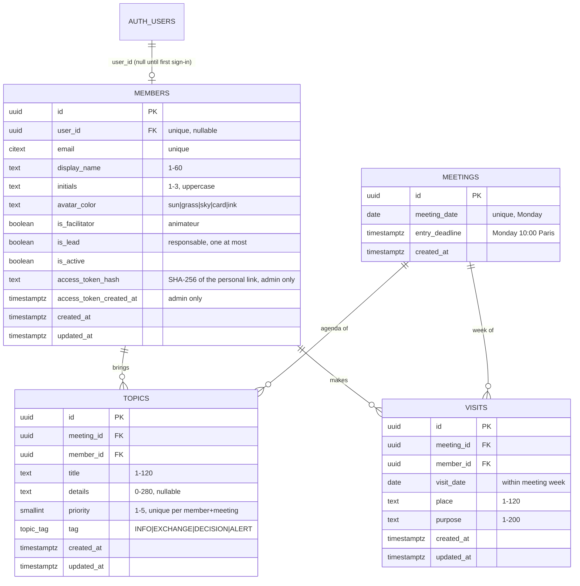

# Data model

Postgres schema managed by versioned migrations in `supabase/migrations/` (created with
`supabase migration new`, **never edited once committed**: fix forward with a new migration).
The database is the last line of defence: every business rule below is enforced here, and
is also checked in the app (Server Actions validated with Zod).

## Schema

- Primary keys `uuid` (`gen_random_uuid()`), timestamps `timestamptz`, SQL names in English `snake_case`.
- Foreign keys from `topics` and `visits` cascade on delete. Members are never deleted (deactivate).
- Every text has a `check` on its length **after `btrim`**: no empty or blank strings.
- `updated_at` is maintained by the generic trigger `private.set_updated_at()`.
- Helpers and trigger functions live in the `private` schema, which the Data API does not expose.

## Business rules and where they are enforced

| Rule                                                                          | Database                                                                                                        | App                              |
| ----------------------------------------------------------------------------- | --------------------------------------------------------------------------------------------------------------- | -------------------------------- |
| A member is active or inactive; inactive members read and write nothing       | `private.current_member_id()` only returns **active** members; every policy depends on it                       | B, middleware                    |
| One **responsable** at most                                                   | partial unique index `members_single_lead_idx` (23505)                                                          | B, Team screen                   |
| At least one active **animateur**                                             | trigger `members_keep_one_facilitator` (P0001, hint `last_facilitator`)                                         | B, middleware                    |
| A meeting is on a Monday, one per date                                        | `check (extract(isodow …) = 1)`, `unique (meeting_date)`                                                        | C                                |
| Entry closes at the stored deadline (Monday 10:00 Paris)                      | RLS (`private.is_entry_open`) + trigger `*_entry_open` for a readable error (P0001, hint `entry_closed`)        | C computes the deadline          |
| 5 topics max per member and meeting                                           | trigger `topics_max_five` (P0001, hint `topics_max_five`), with an advisory lock                                | D                                |
| Priority 1–5, unique per member and meeting                                   | `check`, constraint `topics_member_priority_unique` **deferrable initially deferred** (swap in one transaction) | D                                |
| One tag among 4                                                               | enum `topic_tag`                                                                                                | D (`src/lib/topicTags.ts`)       |
| Visit date within the meeting week (Mon–Sun)                                  | trigger `visits_in_meeting_week` (P0001, hint `visit_outside_meeting_week`)                                     | E                                |
| Members only write their own entries; `meeting_id` / `member_id` never change | RLS `with check` + column-level `UPDATE` privileges                                                             | D, E                             |
| `user_id` is linked server-side only                                          | no `INSERT`/`UPDATE` privilege on `members.user_id` for API users                                               | admin client (`src/server/auth`) |
| Personal link: only the SHA-256 is stored, invisible to API users             | `access_token_hash` format check, column-level `SELECT` without the token columns                               | `docs/auth.md`                   |
| Moving the responsable role is atomic                                         | `public.set_lead(uuid)` (security invoker, facilitators only)                                                   | Team screen                      |
| Nothing kept after the meeting                                                | —                                                                                                               | H (client only)                  |

Database errors are translated into business errors by `src/server/errors.ts`
(`toDomainError`): codes `TOPICS_LIMIT_REACHED`, `DUPLICATE_PRIORITY`, `ENTRY_CLOSED`,
`VISIT_OUTSIDE_WEEK`, `LEAD_ALREADY_ASSIGNED`, `LAST_FACILITATOR`, `DUPLICATE_EMAIL`,
`INVALID_INPUT`, `FORBIDDEN`, `UNKNOWN`, each with a French message.

## Access rules

RLS is enabled on the 4 tables. Default deny: all privileges are revoked from `anon` and
`authenticated`, then granted table by table (column by column for writes). `anon` has no
privilege at all. `service_role` (admin client, server only) bypasses RLS.

Helper functions (`private` schema, `security definer`, `search_path = ''`, `stable`):

| Function                        | Returns                                                     |
| ------------------------------- | ----------------------------------------------------------- |
| `current_member_id()`           | id of the **active** member linked to `auth.uid()`, or null |
| `is_facilitator()`              | current active member has the animateur role                |
| `is_lead()`                     | current active member is the responsable                    |
| `is_entry_open(meeting_id)`     | `now() < entry_deadline`                                    |
| `is_meeting_closed(meeting_id)` | `now() >= entry_deadline`                                   |

| Table      | SELECT                                                            | INSERT                                       | UPDATE                                                           | DELETE               |
| ---------- | ----------------------------------------------------------------- | -------------------------------------------- | ---------------------------------------------------------------- | -------------------- |
| `members`  | any active member (not the token columns)                         | animateur (not `user_id`, not token columns) | animateur (not `user_id`, not token columns)                     | nobody (deactivate)  |
| `meetings` | any active member                                                 | nobody (admin client)                        | nobody                                                           | nobody               |
| `topics`   | own **or** responsable **or** (animateur **and** deadline passed) | own, before deadline                         | own, before deadline; only `title`, `details`, `priority`, `tag` | own, before deadline |
| `visits`   | own **or** responsable **or** (animateur **and** deadline passed) | own, before deadline                         | own, before deadline; only `visit_date`, `place`, `purpose`      | own, before deadline |

Note: a refused UPDATE or DELETE under RLS is **silent** (0 rows affected). The app checks the
number of affected rows (`.select()` after `update`/`delete`).

## Tests

`supabase/tests/database/*.test.sql` (pgTAP, `pnpm test:db`): constraints and triggers,
visibility per role and per deadline, writes before/after the deadline and for another
member, inactive members, users without a member profile, anonymous users; plus schema-level
checks (RLS enabled on every `public` table, no `anon` privilege, immutable columns, pinned
`search_path` on security definer helpers). Fixtures are fictitious and rolled back.

## Demo data

`supabase/seed.sql` (loaded by `pnpm db:reset`), **fictitious**: « Membre Démo 1 » to « 5 »
(`membre1@example.test` …; 1 = animateur, 2 = responsable), their auth accounts, next Monday's
meeting with 0 to 5 topics per member (all tags) and a few visits.
